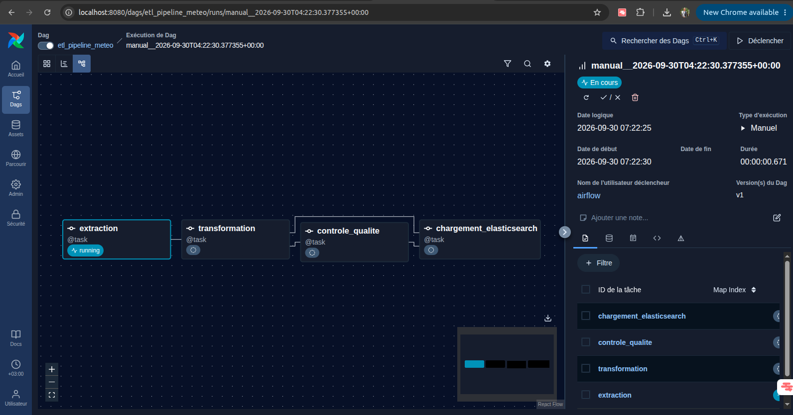
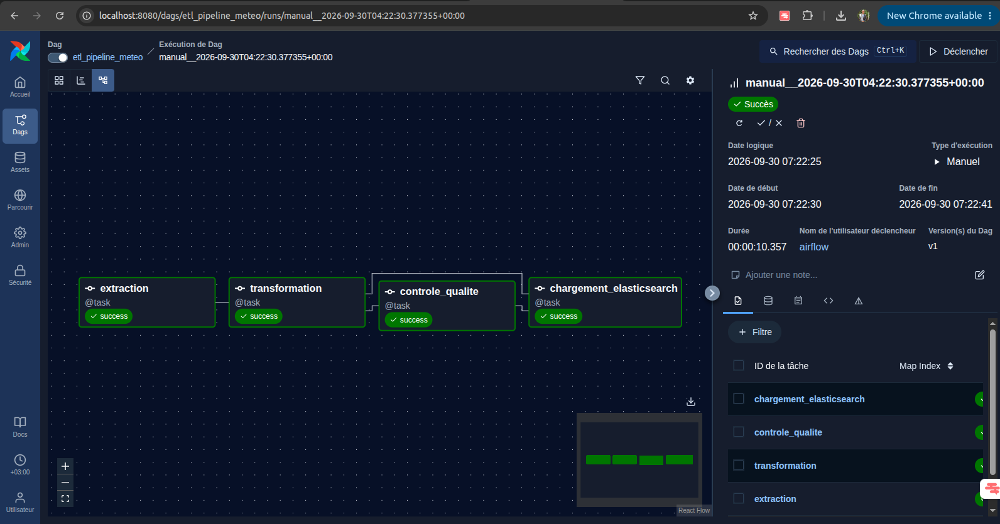
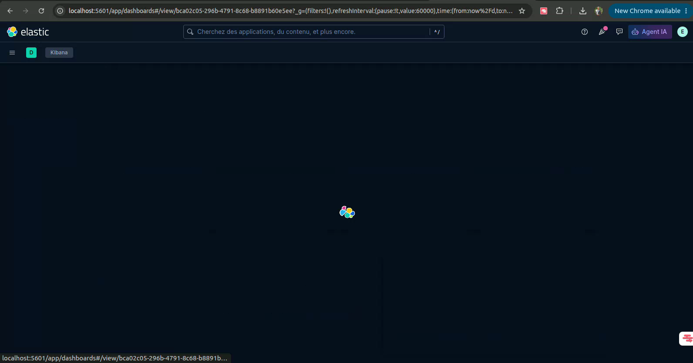

# Pipeline ETL Meteo Madagascar

**Projet Final — Construction d'un pipeline ETL avec Apache Airflow, Elasticsearch et Kibana**

---

## Apercu du projet

### DAG Airflow `etl_pipeline_meteo` — etat initial (avant execution)



### DAG Airflow `etl_pipeline_meteo` — execution complete reussie



### Demonstration video du Dashboard Kibana

[](docs/visualisationkibana.webm)

**[Cliquer ici pour lire/telecharger la video de demonstration](docs/visualisationkibana.webm)**
(navigation dans les 5 visualisations du Dashboard "Dashboard Meteo Madagascar").

---

## 1. Contexte

Ce projet met en place une plateforme de collecte, transformation, analyse et visualisation de
donnees **meteorologiques** pour six grandes villes de Madagascar (Antananarivo, Toamasina,
Antsirabe, Mahajanga, Fianarantsoa, Toliara).

Les previsions horaires (temperature, humidite, precipitation, vent, code meteo) sont recuperees
automatiquement depuis l'API publique et gratuite **Open-Meteo** (https://open-meteo.com/, aucune
cle d'API requise, ce qui garantit la reproductibilite totale du projet), puis orchestrees par
**Apache Airflow**, stockees dans **Elasticsearch**, et visualisees dans **Kibana**.

Domaine choisi parmi la liste du sujet : **meteo et environnement**.

---

## 2. Architecture

```
API Open-Meteo (JSON)
      |
      v
  [Airflow DAG: etl_pipeline_meteo]
      |
      +--> extraction()               -> data/raw_weather_<run_id>.json
      |
      +--> transformation()           -> data/transformed_weather_<run_id>.json
      |         (dedoublonnage, valeurs manquantes, types, dates, colonne 'condition')
      |
      +--> controle_qualite()         -> rapport qualite (leve une exception si echec)
      |
      +--> chargement_elasticsearch() -> index 'meteo_madagascar' (Elasticsearch)
                                              |
                                              v
                                          Kibana (Discover, Lens, Dashboard)
```

Chaine complete : **Collecter -> Transformer -> Controler -> Charger -> Analyser -> Visualiser**.

---

## 3. Sources de donnees

| Source | Type | Description |
|---|---|---|
| Open-Meteo Forecast API (api.open-meteo.com/v1/forecast) | API REST publique (JSON) | Previsions horaires sur 2 jours : temperature, humidite, precipitation, vent, code meteo WMO |

6 villes interrogees (definies dans `scripts/extract.py`) : Antananarivo, Toamasina, Antsirabe,
Mahajanga, Fianarantsoa, Toliara.

---

## 4. Transformations appliquees (`scripts/transform.py`)

1. **Suppression des doublons** sur le couple `(ville, timestamp)`.
2. **Gestion des valeurs manquantes** : les lignes dont un champ obligatoire (`ville`, `timestamp`,
   `temperature_c`, `humidite_pct`) est absent sont ecartees.
3. **Conversion de types** : temperatures, humidite, precipitation et vent forces en `float`, code
   meteo force en `int`.
4. **Normalisation des dates** : les horodatages Open-Meteo (`YYYY-MM-DDTHH:MM`) sont completes au
   format ISO 8601 (`YYYY-MM-DDTHH:MM:SS`).
5. **Creation d'une nouvelle colonne** `condition` : traduction lisible du code meteo WMO
   (ex. code `3` -> "Couvert", code `61` -> "Pluie legere"), et generation d'un identifiant
   unique `id` (`ville_timestamp`) utilise comme `_id` Elasticsearch.

---

## 5. Controle qualite (`scripts/validate.py`)

Avant chargement, chaque execution verifie :
- **nombre de lignes minimal** (>= 50) ;
- **presence des champs obligatoires** sur chaque document ;
- **types numeriques corrects** (temperature, humidite) ;
- **unicite de l'identifiant** `id` ;
- **plages de valeurs plausibles** (temperature entre -10 et 55 degres C, humidite entre 0 et 100%).

Si un controle echoue, la tache `controle_qualite` leve une `ValueError` : la tache est marquee
`failed`, Airflow declenche les **retries** configures, et le chargement dans Elasticsearch
n'est jamais effectue avec des donnees non valides.

---

## 6. Mapping Elasticsearch (`elasticsearch/mapping.json`)

Index : **`meteo_madagascar`**

| Champ | Type ES | Description |
|---|---|---|
| `id` | keyword | Identifiant unique (ville + horodatage) |
| `ville` | keyword | Nom de la ville |
| `timestamp` | date | Horodatage de la mesure (ISO 8601) |
| `temperature_c` | float | Temperature en degres Celsius |
| `humidite_pct` | float | Humidite relative en % |
| `precipitation_mm` | float | Precipitation en mm |
| `vent_kmh` | float | Vitesse du vent en km/h |
| `weather_code` | integer | Code meteo WMO brut |
| `condition` | keyword | Condition meteo lisible (ex : "Pluie legere") |

---

## 7. DAG Airflow (`dags/etl_pipeline.py`)

- **`dag_id`** : `etl_pipeline_meteo`
- **Planification** : `@daily` (`catchup=False`)
- **4 taches** avec dependances explicites :
  `extraction >> transformation >> controle_qualite >> chargement_elasticsearch`
- **Fonctionnalites Airflow demontrees** :
  - `PythonOperator` (via `@task` TaskFlow) pour chaque etape ;
  - **retries** (3 tentatives, delai de 1 a 2 minutes) en cas d'echec (ex : API temporairement
    indisponible) ;
  - **logs** detailles a chaque etape (chemins de fichiers, resumes, rapports) ;
  - **XCom** : chaque tache retourne un chemin de fichier ou un rapport (dict), automatiquement
    transmis a la tache suivante via XCom ;
  - **connexion vers Elasticsearch** geree via variables d'environnement `ES_HOST`, `ES_USER`,
    `ES_PASSWORD` (transposable en Airflow Connection) ;
  - **tache dediee au controle qualite** (`controle_qualite`) qui bloque le pipeline en cas de
    donnees non conformes.

---

## 8. Analyses realisees

Les requetes d'analyse sont documentees dans `elasticsearch/queries.json`. Exemples de resultats
obtenus sur une execution reelle (288 documents, 6 villes x 48h) :

### Temperature moyenne et precipitation totale par ville

| Ville | Temperature moyenne (degC) | Precipitation totale (mm) |
|---|---|---|
| Mahajanga | 27.70 | 0.0 |
| Toliara | 25.25 | 0.0 |
| Toamasina | 23.19 | 2.9 |
| Antananarivo | 19.85 | 0.0 |
| Antsirabe | 17.18 | 18.1 |
| Fianarantsoa | 16.74 | 1.9 |

**Questions metier auxquelles ces analyses repondent :**
- Quelle est la ville la plus chaude / la plus fraiche sur la periode ? -> Mahajanga la plus
  chaude, Fianarantsoa la plus fraiche.
- Quelle ville a recu le plus de pluie ? -> Antsirabe (18.1 mm cumules).
- Quelle est la repartition des conditions meteo (ciel degage, pluie, orage...) sur l'ensemble
  des villes ?
- Quelles sont les heures a risque de vent fort (> 30 km/h) ?
- Quelle est l'evolution de la temperature heure par heure pour chaque ville ?

---

## 9. Dashboard Kibana (`kibana/dashboard.ndjson`)

Data View : **`meteo_madagascar`** (champ temporel : `timestamp`).

**Dashboard "Dashboard Meteo Madagascar"** regroupant 5 visualisations Lens :

1. **Nombre de mesures par ville** (barres horizontales) : verification du volume de donnees.
2. **Temperature moyenne par ville** (barres verticales) : comparaison des villes.
3. **Precipitation totale par ville** (barres verticales) : identification des zones pluvieuses.
4. **Repartition des conditions meteo** (donut) : proportion de chaque condition (degage, pluie...).
5. **Evolution de la temperature dans le temps par ville** (courbes) : tendance horaire par ville.

> Le fichier `kibana/dashboard.ndjson` contient l'export complet (Data View + 5 visualisations +
> Dashboard), directement reimportable via **Stack Management > Saved Objects > Import**.

> Les captures d'ecran du DAG et la video de demonstration du dashboard sont visibles tout en
> haut de ce README, dans la section **"Apercu du projet"**.

---

## 10. Organisation du depot

```
projet-data-engineering/
  dags/
    etl_pipeline.py
  scripts/
    extract.py
    transform.py
    validate.py
    load.py
  data/                      (fichiers generes a l'execution, ignores par git)
  elasticsearch/
    mapping.json
    queries.json
  kibana/
    dashboard.ndjson
  docs/
    DAGetlpipelineMETEOinit.png
    DAGetlpipelineMETEOsuccess.png
    visualisationkibana.webm
    visualisationkibana_thumbnail.png
  docker-compose.yml
  requirements.txt
  README.md
```

---

## 11. Instructions pour lancer le projet

### Prerequis
- Docker et Docker Compose installes.

### Etapes

```bash
# 1. Cloner le depot
git clone <url-du-depot>
cd projet-data-engineering

# 2. Demarrer toute la stack (Postgres, Elasticsearch, Kibana, Airflow)
docker compose up -d

# 3. Attendre que tous les services soient healthy (2 a 3 minutes)
docker compose ps

# 4. Ouvrir l'interface Airflow
# http://localhost:8080  (identifiants : admin / admin)

# 5. Activer (unpause) puis declencher le DAG etl_pipeline_meteo depuis l'UI
# ou en ligne de commande :
docker compose exec airflow-webserver airflow dags unpause etl_pipeline_meteo
docker compose exec airflow-webserver airflow dags trigger etl_pipeline_meteo

# 6. Verifier les donnees indexees dans Elasticsearch
curl -u elastic:changeme123 http://localhost:9200/meteo_madagascar/_count

# 7. Ouvrir Kibana et importer le dashboard
# http://localhost:5601
# Stack Management > Saved Objects > Import > selectionner kibana/dashboard.ndjson
```

### Variables d'environnement importantes
- `ES_HOST` (defaut : `http://elasticsearch:9200`)
- `ES_USER` (defaut : `elastic`)
- `ES_PASSWORD` (defaut : `changeme123`, modifiable via la variable `ELASTIC_PASSWORD`)

---

## 12. Parcours d'une donnee (resume)

1. **Collecte** : le DAG interroge l'API Open-Meteo pour chacune des 6 villes et sauvegarde un
   JSON brut horodate par execution (`data/raw_weather_<run_id>.json`).
2. **Transformation** : le JSON imbrique (colonnes paralleles par variable) est aplati en une
   liste de documents, dedoublonne, nettoye, type, et enrichi d'une colonne `condition`.
3. **Controle** : un rapport qualite verifie le volume, les champs obligatoires, les types, les
   doublons d'identifiant et les plages de valeurs ; toute anomalie bloque le pipeline.
4. **Stockage** : les documents valides sont charges en masse (`_bulk`) dans l'index
   `meteo_madagascar` d'Elasticsearch, avec un mapping explicite.
5. **Analyse** : des agregations (moyenne, somme, repartition par termes) repondent a des
   questions concretes sur les temperatures, precipitations et conditions meteo par ville.
6. **Visualisation** : Kibana Discover permet l'exploration libre, et un dashboard regroupe 5
   visualisations Lens pour une lecture synthetique des indicateurs cles.
